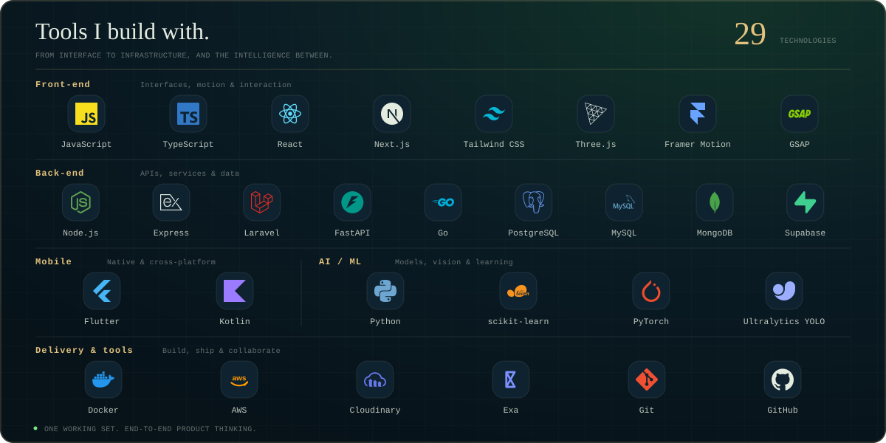

<!-- Independent GitHub profile README. Keep assets/ beside this file. -->

  

 

  
  &nbsp;
  
  &nbsp;
  

 

> **Clean architecture, purposeful motion.** I care about the complete product: how it looks, how it works, and whether it solves something real.

## About

I'm **Faza Izzaturrafi**, a Software Engineering student at **IPB University**, aspiring to build products end to end. My work covers web interfaces, reliable backend systems, and AI/ML-powered features for real-world problems.

I enjoy moving between disciplines: shaping an interface, designing the data behind it, connecting the services, and adding intelligence where it genuinely helps. The goal is not complexity for its own sake—it is software people find genuinely useful.

  <code>South Tangerang, Indonesia</code>
  &nbsp;
  <code>Software Engineering · IPB University</code>
  &nbsp;
  <code>Web · Mobile · Backend · Machine Learning</code>

 

  

## Toolbox

  

---

  <h3>Have a problem worth solving?</h3>
  
Let’s build something useful.

  

    <a href="mailto:izzaturrafi.faza@gmail.com"><strong>Email</strong></a>
    &nbsp;·&nbsp;
    <a href="https://www.linkedin.com/in/fazaizzaturrafi"><strong>LinkedIn</strong></a>
    &nbsp;·&nbsp;
    <a href="https://github.com/arzghy"><strong>GitHub</strong></a>
    &nbsp;·&nbsp;
    <a href="https://fazaiztrf.vercel.app"><strong>Portfolio</strong></a>
  

   
  <code>South Tangerang, Indonesia</code>

