<!-- Independent GitHub profile README. Keep assets/ beside this file. -->

  

 

  
  &nbsp;
  
  &nbsp;
  

 

> **Clean architecture, purposeful motion.** I care about the complete product: how it looks, how it works, and whether it solves something real.

## About

I'm **Faza Izzaturrafi**, a Software Engineering student at **IPB University**, aspiring to build products end to end. My work covers web interfaces, reliable backend systems, and AI/ML-powered features for real-world problems.

I enjoy moving between disciplines: shaping an interface, designing the data behind it, connecting the services, and adding intelligence where it genuinely helps. The goal is not complexity for its own sake—it is software people find genuinely useful.

  <code>South Tangerang, Indonesia</code>
  &nbsp;
  <code>Software Engineering · IPB University</code>
  &nbsp;
  <code>Web · Mobile · Backend · Machine Learning</code>

 

  

## Selected products

Nine products and case studies spanning public transport, computer vision, education, health, digital security, and mobile services. Open a product to see its role and core stack.

  
<strong>Rafamer</strong> — a studio portfolio with game-style character selection

  A three-person studio portfolio that introduces each developer and their specialty through an interactive character-selection experience.

  <code>Next.js</code> <code>TypeScript</code> <code>GSAP</code> <code>Three.js</code>

  **[Visit Rafamer](https://rafamer.vercel.app)**

  
<strong>TransGIS</strong> — public-transport route planning for Bogor

  A public-transport guide with interactive route planning for BisKita and angkot trayek, making local journeys easier to understand.

  <code>Next.js</code> <code>MapLibre GL</code> <code>PostgreSQL</code>

  **[Visit TransGIS](https://transgis.vercel.app)**

  
<strong>AegisFlame</strong> — AI-powered fire and smoke detection

  A YOLO-powered detection workspace for live cameras, uploaded recordings, and single frames.

  <code>Next.js</code> <code>FastAPI</code> <code>PyTorch</code> <code>YOLO</code>

  **[Visit AegisFlame](https://aegisflame.vercel.app)**

  
<strong>Kanjira</strong> — adaptive kanji learning for JLPT N5–N3

  A kanji learning platform with animated stroke order, adaptive spaced repetition, quizzes, and habit tracking.

  <code>Next.js</code> <code>Golang</code> <code>MongoDB</code> <code>GSAP</code>

  **[Visit Kanjira](https://kanjira.vercel.app)**

  
<strong>Ayunian</strong> — a reusable product catalogue and company website

  A responsive product catalogue and company information website built on one reusable component system.

  <code>Next.js</code> <code>TypeScript</code> <code>Tailwind CSS</code>

  **[Visit Ayunian](https://ayunian.vercel.app)**

  
<strong>Nutrily</strong> — personalized nutrition tracking with an AI assistant

  A personalized nutrition app with profile-based targets, meal logging, label scanning, and an AI assistant.

  <code>React</code> <code>Golang</code> <code>Supabase</code> <code>Docker</code>

  **[Visit Nutrily](https://nutrily.sensoranote.site)**

  
<strong>ThreatLens</strong> — community-powered digital-security checks

  A digital-security platform for checking scam numbers, links, and Android apps through automated scans and citizen reports.

  <code>React</code> <code>Golang</code> <code>FastAPI</code> <code>Supabase</code>

  **[Visit ThreatLens](https://threatlens.sensoranote.site)**

  
<strong>SensoraNote</strong> — social learning with verified experts and AI tools

  A social learning platform with shared notes, verified experts, AI study tools, localization, and admin moderation.

  <code>Laravel</code> <code>React</code> <code>MongoDB</code> <code>FastAPI</code>

  **[Visit SensoraNote](https://sensoranote.site)**

  
<strong>SteamGo</strong> — mobile booking for steam-wash services

  A mobile booking app with advance and on-site orders, one FIFO queue, and static QRIS payment.

  <code>Flutter</code> <code>Laravel</code> <code>Supabase</code>

  **Mobile product case study**

   
  <a href="https://fazaiztrf.vercel.app/projects"><strong>Browse the complete project archive →</strong></a>

## Toolbox

  

---

  <h3>Have a problem worth solving?</h3>
  
Let’s build something useful.

  

    <a href="mailto:izzaturrafi.faza@gmail.com"><strong>Email</strong></a>
    &nbsp;·&nbsp;
    <a href="https://www.linkedin.com/in/fazaizzaturrafi"><strong>LinkedIn</strong></a>
    &nbsp;·&nbsp;
    <a href="https://github.com/arzghy"><strong>GitHub</strong></a>
    &nbsp;·&nbsp;
    <a href="https://fazaiztrf.vercel.app"><strong>Portfolio</strong></a>
  

   
  <code>South Tangerang, Indonesia</code>

